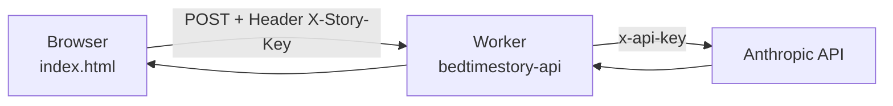

# bedtimestory – Gute Nacht Geschichte

Webseite, die per KI eine Gute-Nacht-Geschichte für Kinder erzeugt. Man wählt
ein Kinderprofil (Name, Alter, Geschlecht), 1–5 Genres und die Lesedauer
(kurz / mittel / lang). Die Geschichte kann vorgelesen (Browser-Sprachausgabe)
oder gedruckt werden.

Live: <https://bedtime.aininger.com>

## Auf einen Blick

| | |
|---|---|
| Frontend | statisch, eine Datei (`index.html`), GitHub Pages, Domain per `CNAME` |
| Backend | Cloudflare Worker `bedtimestory-api` (`cloudflare/generate-story.js`) |
| Worker-URL | `https://bedtimestory-api.mario-aininger.workers.dev` |
| Externe Quelle | Anthropic Messages API (`api.anthropic.com/v1/messages`) |
| Secrets | `ANTHROPIC_API_KEY`, `STORY_KEY` |
| Speicher | nur Browser (`localStorage`), nichts auf dem Server |

## Datenfluss



1. Der Browser schickt `name`, `age`, `gender`, `genres[]` und `duration` per POST an den Worker.
2. Der Worker prüft das Zugangswort (`X-Story-Key` gegen das Secret `STORY_KEY`).
3. Der Worker baut System- und User-Prompt, ruft die Anthropic API auf (Modell und `max_tokens` stehen in `generate-story.js`) und gibt `{ title, story }` zurück.
4. Der API-Key liegt nur als Worker-Secret vor und erreicht nie den Browser.

Die Eingaben werden im Worker gekürzt (Name 40 Zeichen, max. 5 Genres,
Dauer nur `kurz`/`mittel`/`lang`). Zielwörter: kurz 400–600, mittel 900–1200,
lang 1500–1900.

## Zugriffsschutz („Zauberwort“)

Jeder Aufruf kostet Anthropic-Tokens. Deshalb verlangt der Worker ein Zugangswort:

- Header `X-Story-Key` muss dem Secret `STORY_KEY` entsprechen.
- Ohne gesetztes Secret lehnt der Worker alles ab (fail closed, HTTP 503).
- Der Vergleich läuft über SHA-256-Hashes ohne vorzeitigen Abbruch, bei falschem Wort kommt eine Bremse von 400 ms.
- Die Seite fragt das Zauberwort einmal ab und merkt es im Browser (`localStorage`, Schlüssel `gnc_storykey`).
- CORS: `ALLOWED_ORIGIN` (Variable im Worker) beschränkt, welche Seite den Worker aufrufen darf. Ohne Wert gilt `*`.

## Einrichtung / Deployment

```bash
cd cloudflare
wrangler login
wrangler secret put ANTHROPIC_API_KEY
wrangler secret put STORY_KEY
wrangler deploy
```

Danach in `index.html` die Konstante `STORY_API_ENDPOINT` auf die Worker-URL
setzen und in GitHub unter Settings → Pages den Branch `main`, Ordner `/`
aktivieren. Die Domain kommt aus der Datei `CNAME`.

## Ändern

| Was | Wo |
|---|---|
| Modell, Prompt, Längen | `cloudflare/generate-story.js` (`DURATION_WORDS`, `systemPrompt`, `model`) |
| Genres, Texte, Aussehen | `index.html` |
| Zauberwort ändern | `wrangler secret put STORY_KEY`, die Seite fragt danach neu |

## Fallstricke

- **Kosten:** Das Zauberwort ist der einzige Schutz. Bei Missbrauch `STORY_KEY` ändern oder den API-Key bei Anthropic sperren.
- **Modellname:** Gibt Anthropic das Modell nicht mehr her, antwortet der Worker mit HTTP 502 und der Anthropic-Fehlermeldung. Dann `model` in `generate-story.js` anpassen und neu deployen.
- **Antwortformat:** Das Modell soll reines JSON liefern. `parseStory()` fängt abgeschnittenes oder in Codeblöcke gepacktes JSON ab, im Notfall wird der Rohtext als Geschichte angezeigt.
- **Kinderdaten:** Name, Alter und Geschlecht gehen mit jeder Anfrage an Anthropic. Auf dem Worker oder im Repo wird nichts gespeichert.

## Historie

Früher eine Netlify Function (`netlify/functions/generate-story.js`), jetzt ein Cloudflare Worker.
